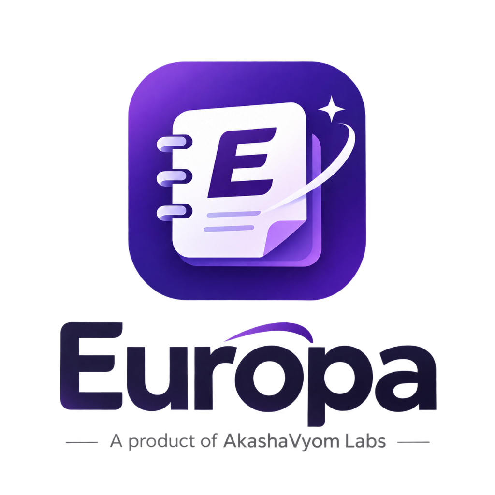

# Europa — Digital Notebook and AI Knowledge Workspace
### A Product of AkashaVyom Labs



Europa is a production-quality, desktop-first web-based digital notebook and AI knowledge workspace inspired by Microsoft OneNote, engineered for students, researchers, knowledge workers, and technical professionals.

---

## 🚀 Key Highlights & Architectural Features

### 1. Genuine Free-Form Note Canvas (Microsoft OneNote Experience)
- **Click Anywhere to Type**: Unlike conventional document editors that force users into rigid A4 word-processor pages, Europa features an infinite 2D canvas where users can double-click anywhere to spawn movable text containers.
- **Independent Canvas Containers**: Text containers, checklists, code snippets, KaTeX equations, callouts, audio memos, and images have their own $(X, Y)$ coordinate space, layer ordering ($z$-index), width resizing, and lock controls.
- **OneNote Container Handles**: Subtle drag handles appear on container hover/focus, allowing intuitive 2D repositioning.
- **Customizable Paper Backgrounds**: Seamlessly switch between **Ruled Paper** (with adjustable line spacing slider), **Grid / Graph Paper**, **Dotted Paper**, and clean **Blank Paper**.
- **Infinite Navigation & Zoom**: Smooth 50% to 200% zoom controls and free pan navigation.

### 2. Digital Ink & Vector Drawing Engine
- **Vector Stroke Storage**: All ink drawings are captured as structured vector paths (points, pressure, color, thickness, opacity) rather than flattened bitmap images, ensuring drawings remain editable, scalable, and crisp after reopening notebooks.
- **Drawing Instruments**: High-precision Pen, Pencil, Highlighter (with 35% translucency blend mode), Marker, and Eraser.
- **Geometric Shapes**: Straight lines, directional arrows, rectangles, and circles.
- **Stylus & Pressure Sensitivity**: Full PointerEvent pressure sensitivity support.

### 3. Hierarchical Notebook Navigation
- **Notebooks → Section Groups → Sections → Pages → Subpages**
- **Section Color Strips**: Distinct OneNote-style color badges on sections.
- **Password Protected Sections**: Cryptographically hashed password protection with instant unlock prompts.
- **Page Management**: Pinned pages float to top, favorite star markers, timestamp logs, and instant search filter.

### 4. Provider-Independent AI Assistant & Notebook RAG System
- **Provider-Independent Architecture**: Configured on backend with zero frontend code modifications. Supports:
  - **Google Gemini API** (Gemini 1.5 Flash)
  - **Groq API** (Llama 3.3 70B Versatile at ultra-low latency)
  - **OpenRouter Compatible Models**
  - **Ollama** (Local private self-hosted models)
  - **Europa Built-in Local Knowledge Engine** (Deterministic offline fallback requiring zero external API keys)
- **Grounded Notebook RAG Pipeline**:
  - Extracts text from page canvas blocks and attachments.
  - Generates semantic embeddings and computes vector similarity against user queries.
  - Injects retrieved chunks into LLM prompt with strict isolation rules (documents treated as untrusted data, not system instructions).
  - Emits clickable citations `[Citation X - Page: "Topic"]` linking directly to source pages.
- **Context Scope Selector**:
  - Selected text only
  - Current page
  - Current section
  - Current notebook
  - All authorized notebooks
- **Integrated Assistant Capabilities**: Summarize, Generate Practice Quizzes / MCQs, Study Flashcards, Mind-map outlines, and Extract Action Items.

### 5. Tag & Task Management Vault
- **Tagging System**: Cross-notebook tag tracking (`todo`, `important`, `question`, `definition`, `exam`, `idea`, `custom`).
- **Tag Summary Panel**: Dedicated side panel grouping all tagged notes across all notebooks with one-click page navigation.
- **Tasks & Checklist Vault**: Interactive task manager with priorities (Low, Medium, High, Urgent), due dates, and completion status.

### 6. Templates Vault
- 15 real editable built-in templates:
  1. Blank Canvas
  2. Cornell Notes
  3. Meeting Minutes
  4. Lecture Notes
  5. Competitive Exam Prep
  6. Research Notebook
  7. Daily Journal
  8. Weekly Planner
  9. Software Architecture Spec
  10. Project Notebook
  11. Business Model Canvas
  12. Personal Knowledge Base (Zettelkasten)
  13. Eisenhower Priority Matrix
  14. Active Recall Study Revision
  15. Titan Document Bridge

### 7. AkashaVyom Titan Integration
- **Titan SSO & Unified Authentication**: Seamless token verification endpoint (`/api/auth/titan-sso`).
- **Titan Document Exchange Format**: One-click export to Titan Document v1.0 JSON format preserving hierarchy and blocks.

### 8. Import & Export
- Export single pages, sections, or notebooks to **Markdown (.md)**, **HTML**, **Structured JSON**, and **Titan Document**.
- Local caching & offline recovery via **IndexedDB** (`idb-keyval`).

---

## 🛠️ Technology Stack

- **Frontend**: React 18, TypeScript, Vite, Tailwind CSS, Tiptap / ProseMirror, Lucide Icons, KaTeX.
- **Backend**: Python 3.12, FastAPI, Pydantic v2, Motor / PyMongo, Python-Jose (JWT), Passlib / Bcrypt, HTTPX, Uvicorn.
- **Database Engine**: Hybrid Dual-Engine:
  - **MongoDB Atlas** when `MONGODB_URI` is provided.
  - **High-Performance Local Document Store** with ACID JSON persistence for zero-friction local development.

---

## 📦 Installation & Quick Start

### 1. Prerequisites
- Node.js v18+ & npm
- Python 3.10+

### 2. Backend Setup
```powershell
# Navigate to backend directory
cd backend

# Create virtual environment (optional)
python -m venv venv
.\venv\Scripts\activate

# Install requirements
pip install -r requirements.txt

# Run the FastAPI server
python -m uvicorn backend.main:app --host 127.0.0.1 --port 8000 --reload
```

The backend API will be live at `http://127.0.0.1:8000` with interactive Swagger docs at `http://127.0.0.1:8000/docs`.

### 3. Frontend Setup
```powershell
# Navigate to frontend directory
cd frontend

# Install dependencies (already installed if in repo)
npm install

# Start Vite dev server
npm run dev
```

Open `http://localhost:5173` in your browser.

---

## 🧪 Automated Testing

Run the automated backend test suite covering all 12 core acceptance criteria:
```powershell
python -m backend.test_api
```

Build the frontend production bundle:
```powershell
cd frontend
npm run build
```

---

## 🏢 Brand Attribution
**Parent Company:** AkashaVyom Labs  
**Product Name:** Europa  
**Product Category:** Digital Notebook, Knowledge Management and AI Productivity Software.

